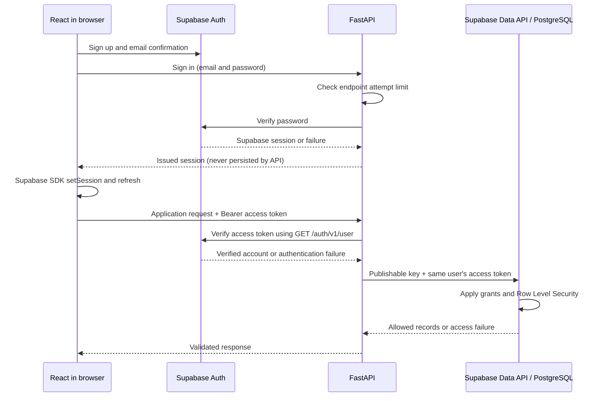

# Rihla architecture

React provides the interface and uses Supabase Auth. FastAPI verifies accounts and owns application rules. Supabase provides authentication and PostgreSQL storage through user-scoped requests.

## What works in this foundation

- A React/Vite/TypeScript setup page reports the backend connection status.
- FastAPI exposes a public `GET /health` endpoint returning HTTP 200 and `{"status":"ok","service":"rihla-api"}`.
- Environment settings configure the backend address and allowed frontend origins.
- The frontend can prepare a Supabase client when a project URL and publishable key are configured. Missing configuration does not prevent the setup page from running.
- Local checks and GitHub Actions can run without Supabase credentials.

The health response establishes that the API process responds. It does **not** check Supabase, validate a session, or prove that a database is available. Supabase configuration being present is also not proof that its values are correct or that authentication works.

The agreed Sprint 1 application flows are implemented, including derived readiness, private administrator status monitoring, shared dates and the user-approved backend endpoint login limit. The user reported successful hosted profile saving; hosted trip/preferences/planning verification remains outstanding in our records. Migrations were tested locally, not applied remotely by this implementation. See [Sprint 1 verification and limits](sprint-1-verification.md), [accounts](authentication.md), [trips/invitations](trips-and-invitations.md), [preferences](member-preferences.md) and [agreed rules](sprint-1-decisions.md).

## Repository map

| Location | Purpose |
| --- | --- |
| `frontend/src/components/` | Reusable interface elements such as status cards |
| `frontend/src/pages/` | Page components; starts with the setup page |
| `frontend/src/lib/` | API requests, configuration, and Supabase client initialization |
| `frontend/src/types/` | Shared frontend TypeScript types |
| `backend/app/main.py` | Creates FastAPI and connects middleware and routes |
| `backend/app/api/routes/` | HTTP endpoints; starts with health |
| `backend/app/core/` | Environment settings and future shared infrastructure |
| `backend/app/schemas/` | Validated request and response models, starting with health |
| `backend/app/services/` | User-scoped Supabase integration and persistent endpoint login protection |
| `backend/tests/` | API and application tests |
| `supabase/migrations/` | Reviewed account, trip, preference and planning SQL/functions/grants/RLS |
| `supabase/tests/` | PostgreSQL permission/domain tests and a disposable fictional preview |
| `docs/` | Architecture and team documentation |
| `.github/workflows/` | Automated checks for changes submitted to GitHub |

Empty folders are extension points, not completed features. Keep new code in the existing layers; add another layer only when it has a concrete purpose.

## Intended authentication and data flow

Registration uses the Supabase browser SDK. The accepted Free-plan sign-in flow uses FastAPI to limit attempts before Supabase verifies passwords. The SDK installs the returned session and owns refresh. All authenticated application requests retain the same user-scoped access flow.

1. React uses the Supabase Auth SDK for registration, session installation/refresh and sign-out. Password sign-in passes transiently through FastAPI for the accepted endpoint-only attempt limit; Supabase still verifies/hashes passwords. Rihla does not store passwords, tokens or custom password hashes. Local ignored SQLite stores only hashed email keys and login timing metadata. This does not block direct Supabase Auth calls; see [the accepted protection and deployment boundary](sprint-1-verification.md). See [Supabase password authentication](https://supabase.com/docs/guides/auth/passwords).
2. React sends the current access token to FastAPI as `Authorization: Bearer <user-access-token>`. Do not send refresh tokens to application endpoints or log tokens.
3. FastAPI sends the token to the configured project's Auth `/user` endpoint for authoritative verification. It accepts the returned account UUID/email only on HTTP 200, rejects anonymous accounts, and distinguishes invalid credentials (401) from upstream/configuration failures (503). It never trusts decoded-but-unverified claims or a client-supplied owner. This network verification adds an Auth request to each application request; local JWKS verification could be considered later if needed. See [Supabase verified user retrieval](https://supabase.com/docs/reference/python/auth-getuser).
4. Profile access is restricted to the verified owner. Trip functions use `auth.uid()` from the same user token to enforce membership and administrator permissions. Atomic trip creation/join/invitation changes use narrow guarded RPCs; direct table writes are denied. The trip administrator is derived from its creator, not a global platform role or Supabase `service_role`. Member display names are shared only through an authorized roster response; private profile rows and emails remain restricted.
5. For normal data operations, FastAPI calls the Supabase Data API in that user's context: the project publishable key identifies the application, and the user's access token identifies the user. Keep each user's token/request context isolated; do not mutate a shared client's session between users. See [Supabase API keys](https://supabase.com/docs/guides/getting-started/api-keys).
6. PostgreSQL applies grants and RLS policies. FastAPI authorization and database policies must agree. Frontend route guards improve navigation but cannot secure records. Because the Data API can be called independently of FastAPI, RLS must also protect business invariants and restricted writes; use controlled database operations where a rule needs an atomic transaction. See [Supabase RLS](https://supabase.com/docs/guides/database/postgres/row-level-security).

No privileged secret or legacy `service_role` key is needed for the normal user request path. Such keys bypass RLS; they must never appear in browser code or any `VITE_` variable. See [Supabase API keys](https://supabase.com/docs/guides/getting-started/api-keys).

Preferences use invoker RPCs and owner-only RLS. Planning uses a narrowly scoped definer function after membership checks because shared-date aggregation must inspect private rows without exposing them. Ordinary members receive their own missing fields and the group date result. Administrators additionally receive status-only member readiness. Results are derived on read, so edits and new joins need no trigger/materialized flag and cannot leave stale readiness stored in a table.

## Configuration boundaries

| Component | Variable | Purpose |
| --- | --- | --- |
| Frontend | `VITE_API_BASE_URL` | FastAPI URL, `http://localhost:8001` locally |
| Frontend | `VITE_SUPABASE_URL` | Supabase project URL |
| Frontend | `VITE_SUPABASE_PUBLISHABLE_KEY` | Browser-safe publishable key |
| Backend | `APP_ENV` | Runtime environment label |
| Backend | `CORS_ORIGINS` | JSON list of allowed frontend origins |
| Backend | `SUPABASE_URL` | Project URL; optional for health, required for account endpoints |
| Backend | `SUPABASE_PUBLISHABLE_KEY` | Application key for verified user-scoped integration |

Vite exposes `VITE_` values in the delivered browser bundle. They cannot hold secrets. Copy the frontend example to `frontend/.env.local` and the backend example to `backend/.env`; keep the real files out of Git. Restart the relevant development server after changing configuration.

CORS allows specified browser origins to read backend responses. It is not authentication or authorization. Keep the local frontend URL consistent with `CORS_ORIGINS`; scheme, hostname, and port all matter. Setup and troubleshooting commands are in the [root README](../README.md).

## Decisions before trip migrations

The user has agreed the core Sprint 1 rules in [sprint-1-decisions.md](sprint-1-decisions.md). Departure city is required; budgets are SAR only; one inclusive date range per member determines shared dates and duration through intersection; optional preferences use Essential/Flexible without extra levels; invitations are reusable for seven days; and editing is allowed throughout planning.

The administrator's readiness view exposes Ready/Incomplete only, without missing-field names or other members' private inputs. Shared group dates are visible to members. These privacy boundaries must also hold when the Data API is accessed directly.

The exact server-enforced five-failures-in-15-minutes login rule remains outstanding. Email confirmation is retained in the account flow.

Do not turn this entity inventory into an approved schema by accident. Once agreed, introduce constraints, grants, RLS, and meaningful permission tests alongside migrations. Creating a trip and its administrator membership must eventually be atomic; readiness should be derived from the agreed saved-input rules.

The account migration remains focused on owner-controlled profiles. The new trip migration adds `trips`, `trip_members` and `trip_invitations`, with direct writes denied and guarded atomic RPCs enforcing ownership/membership. Tests cover the API boundary and actual PostgreSQL grants/policies. Local testing and pending hosted trip verification are documented separately in [the trip guide](trips-and-invitations.md).
